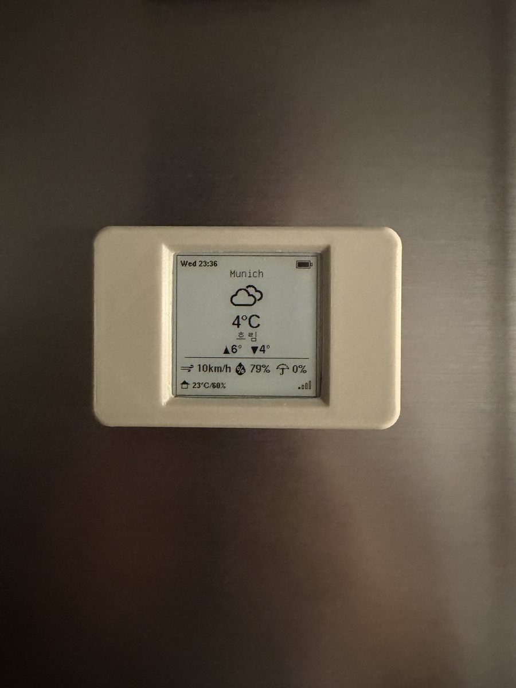
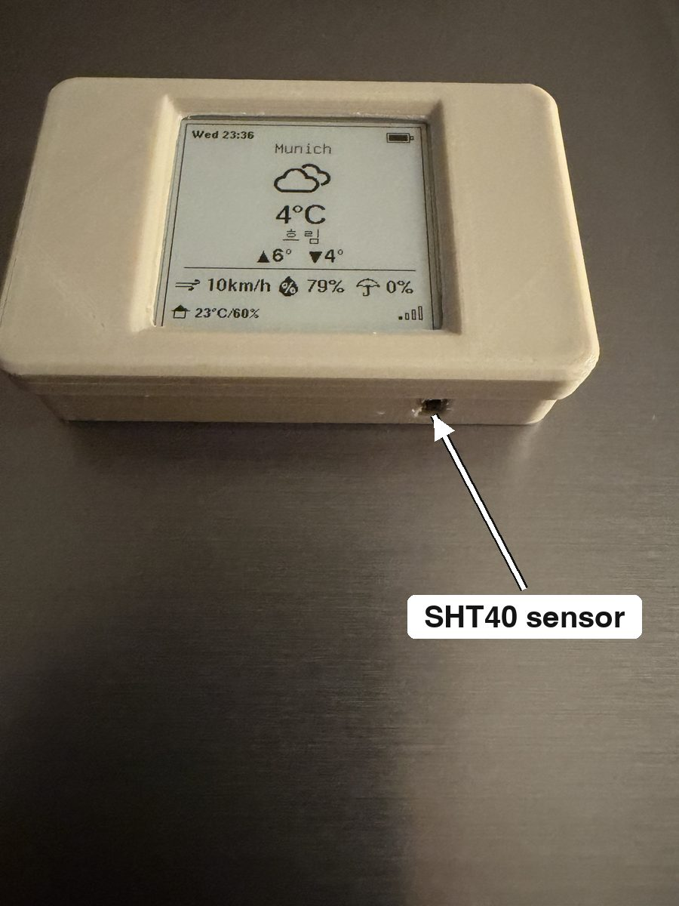
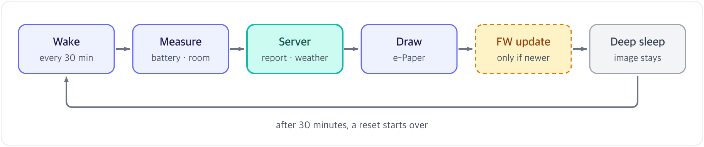
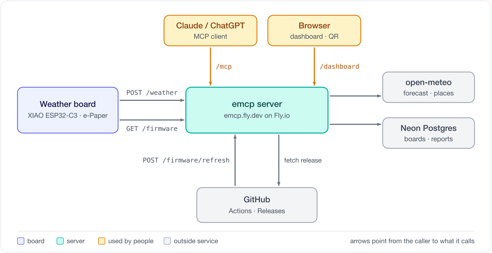
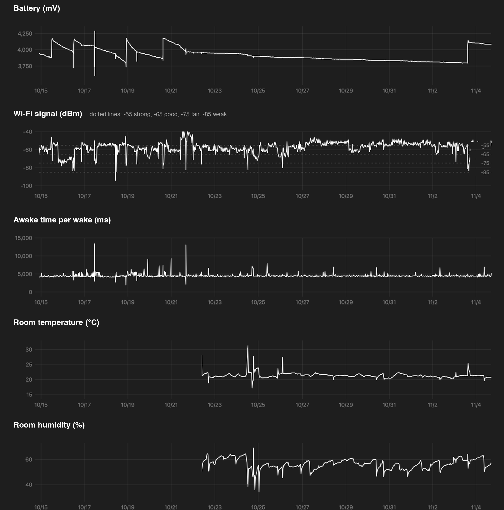
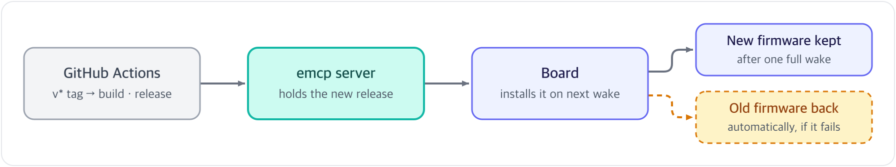

[English](README.md) | [한국어](docs/ko/README.md)

# eink-weather-display

 

 

  
  

A low-power weather display: an ESP32-C3 driving a 1.54" e-Paper. Every 30 minutes it wakes, draws the weather and the room's temperature and humidity, and goes back to deep sleep. It runs for months on a battery.

## Features
| Feature | What it does |
|---|---|
| Weather | Temperature, high and low, conditions, wind, humidity and chance of rain for the board's location, plus room temperature and humidity, battery and Wi-Fi signal |
| Low power | Awake only to refresh, deep sleep the rest of the time. The e-Paper holds its image without power |
| History | Every wake stores the battery, Wi-Fi, room readings and the weather it got on the server, shown as graphs on a dashboard |
| AI (MCP) | From the Claude or ChatGPT app: register a board, change its weather location, rename it, read and analyse the last 7 days of reports |
| Updates | A new release reaches every board over Wi-Fi on its next wake, and a board goes back to its previous firmware if the new one fails |
| Setup | No code to edit: Wi-Fi is set from a phone, and the QR on the screen registers the board to your account |

## How it works

- One HTTPS request per wake carries the report out and the weather back
- The server formats the weather, so the board only draws what it gets and stays light on RAM and power

## The emcp server

The backend is a separate project, [seung-gu/emcp](https://github.com/seung-gu/emcp), running on Fly.io. It looks up the weather, stores the reports, and serves the dashboard, the MCP tools and the firmware.

## Firmware updates

How to publish one, and the rules a board follows: [Firmware layout and updates](docs/en/firmware.md).

## Hardware
| Part | Used |
|---|---|
| MCU | Seeed XIAO ESP32-C3 |
| Display | Waveshare 1.54" e-Paper V2.1 (200×200, black/white) |
| Room sensor | SHT40 (I2C, optional) |
| Power | LiPo battery |

Pins and circuits: [Hardware and wiring](docs/en/hardware.md).

## Getting started
1. Build and upload: `pio run -e weather-xiao -t upload`
2. Wi-Fi: join `XIAO-ESP32-C3` from a phone, open `192.168.4.1` and pick your network
3. Register: scan the QR on the screen and register the board on the dashboard (or give the code to Claude or ChatGPT), then press RESET on the board

Changing networks and upload trouble: [Setup and registration](docs/en/setup.md).

## Docs
| Doc | About |
|---|---|
| [Hardware and wiring](docs/en/hardware.md) | Pin connections, the battery divider, why each pin |
| [Setup and registration](docs/en/setup.md) | Changing Wi-Fi, how registration works, uploading in download mode |
| [Firmware layout and updates](docs/en/firmware.md) | Code layout, one wake in detail, update rules |
| [Registering a board over QR](docs/en/registration.md) | Token and claim code, what each server answer does, the QR screen |
| [Persistence & refresh](docs/en/persistence-and-refresh.md) | Why the last weather lives in NVS, how a partial refresh survives deep sleep |
| [Storing state in NVS](docs/en/nvs-internals.md) | How NVS is laid out, and the `Preferences` API |
| [JTAG debugging](docs/en/jtag-debug.md) | Step debugging over the built-in USB-JTAG |
| [e-Paper power gating](docs/en/epd-power-gating.md) | Switching the module's VCC from a GPIO (parked) |
| [Low-voltage cutoff](docs/en/battery-cutoff.md) | A P-MOSFET that disconnects the battery at 3.4 V |
| [Battery leakage current troubleshooting](docs/en/deep-sleep-drain.md) | Why RST on the V2.1 board has to stay low in deep sleep |

## Changelog
[CHANGELOG.md](CHANGELOG.md).
