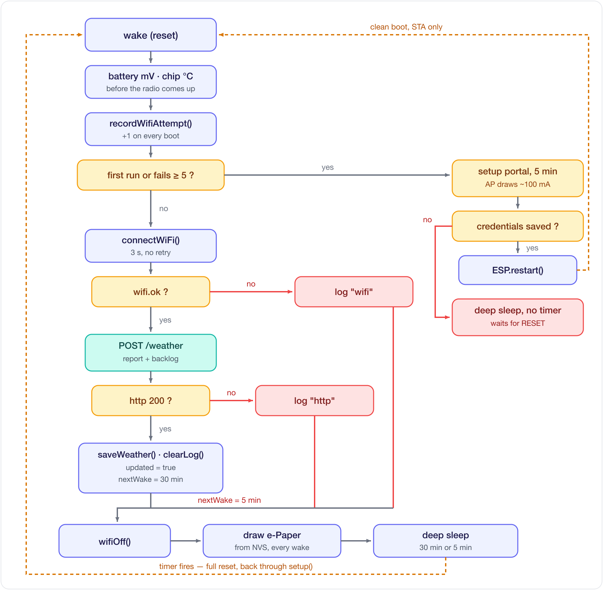
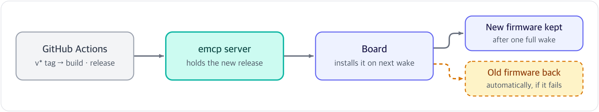

[English](firmware.md) | [한국어](../ko/firmware.md)

# Firmware layout and updates

## One wake in detail


- All the work happens in `setup()`. `loop()` stays empty, because a wake from deep sleep is a full reset
- e-ink is bistable: holding the image takes no current, only a refresh does
- State that has to survive a sleep goes to NVS, not RTC memory (see [Persistence & refresh](persistence-and-refresh.md))
- The next wake is 30 minutes away after the server answered, and 5 minutes away after it did not

## Code layout
```
src/
├─ common/          shared by every build target
│  ├─ config.h         all settings (URLs · pins · intervals)
│  ├─ net.h/.cpp       Wi-Fi connect + HTTPS GET/POST
│  ├─ roots.h          the CA roots the server's certificate is checked against
│  ├─ battery.h/.cpp   battery voltage through the divider
│  ├─ room.h/.cpp      room temperature and humidity from the SHT40
│  ├─ store.h/.cpp     what the board keeps in NVS across sleeps and resets
│  └─ provision.h/.cpp the Wi-Fi setup portal
├─ weather/         the e-Paper display build
│  ├─ display.h/.cpp   e-Paper init + rendering (globals kept static = encapsulated)
│  ├─ weather_icons.h  weather icon bitmaps
│  ├─ ota.h/.cpp       installs a release the server offers, with rollback
│  └─ main.cpp         flow only (setup/loop)
└─ led/             the LED-only build
```

## What the board asks the server
| Request | For |
|---|---|
| `POST /weather` | Every wake: sends its state (battery, Wi-Fi, firmware, room sensor) and gets back the weather for its location, plus a newer firmware if there is one |
| `GET /firmware/<board>/<version>` | Downloads that firmware |
| `/r/<code>` | Not the board itself: the QR it shows before registration, which opens the dashboard with the code filled in |

## Updates over Wi-Fi


```bash
git tag v1.01 && git push origin v1.01
```
- A `v*` tag builds a GitHub release (`.github/workflows/release.yml`) and has the server fetch it. A
  green check on the run means the server holds it. Every board running an older commit installs it
  on its next wake
- The board draws this wake's screen first, then downloads. A download that arrives cut short or
  damaged is never booted
- A board flashed from a laptop with a commit the release does not have (or a `-dirty` build) is left alone
- The new firmware has to reach the server and redraw the screen once. If it does not, the bootloader
  goes back to the previous one. Two tries per release, and none while the battery is under 3.7 V
- Boards flashed before this (no `src/weather/ota.cpp`, default partition table) need one USB upload

## Notes
- The weather condition strings (`뇌우`, `눈`, `비`…) are matched against the server's reply, so they
  stay in Korean in the code
