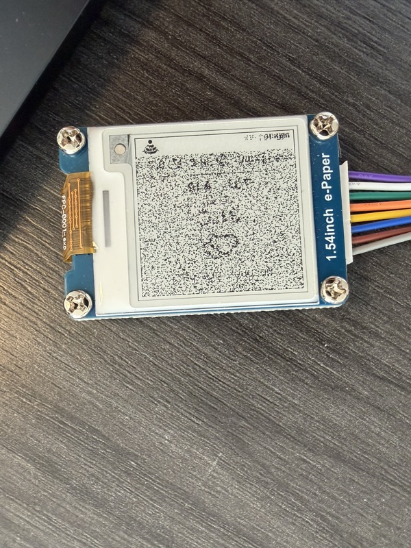

[English](persistence-and-refresh.md) | [한국어](../ko/persistence-and-refresh.md)

# Persistence & refresh

A deep-sleep wake is a full reset. Execution restarts at `setup()` with ordinary RAM gone, and the panel controller comes up reset as well. Two decisions follow:

- The last good response is kept in **NVS** (flash), not RTC memory
- The screen is redrawn with a **partial refresh** over the last frame, which each wake keeps in RTC memory

The first follows from a requirement: when Wi-Fi or the fetch fails, the screen still shows the last known weather plus the status of the *current* wake (`offline`, signal gauge). The second cuts the refresh from 2.6 s to 0.5 s.

Refresh times and currents are this hardware's (an ESP32-C3 with a 1.54" SSD1681 panel), marked where they appear. The GxEPD2 behaviour holds on any board.

Related: [Storing state in NVS](nvs-internals.md).

---

## 1. A partial refresh needs the last frame back in the panel's RAM

### How this module refreshes partially (SSD1681)

Everything in this subsection is about **this module's controller, the SSD1681** (Waveshare 1.54" V2.1, `GxEPD2_154_D67` in GxEPD2). Other controllers were not checked.

The controller holds the picture in two RAMs of its own, on the display module, not in the ESP32's memory:

| RAM | Holds |
|---|---|
| 0x24 | the screen to show next |
| 0x26 | the screen before it: what a partial refresh compares against |

A partial refresh compares the two pixel by pixel and changes only the pixels where they differ. The rest is left alone, which is why it is quick and does not flash:

| 0x26 (before) | 0x24 (next) | The panel |
|---|---|---|
| white | white | leaves it |
| white | black | turns it black |
| black | white | turns it white |
| black | black | leaves it |

So **0x26 has to match what the panel actually shows, pixel for pixel**. Where it does not, the panel leaves pixels alone that needed changing, or drives ones that were already right.

The comparison covers **the whole panel**. On this panel, a partial window over just the bottom status strip still turned the whole screen to noise (photo below). The window only decides where in RAM the data goes, so the RAM outside it has to be right too.

A full refresh does not rely on the comparison. It flashes the whole screen black and white a few times to put every pixel in a known state, then draws the new picture. GxEPD2 writes the same picture into both RAMs first (`writeImageForFullRefresh()`). No precondition, but slow and flashing:

| | Refresh time *(this panel)* | Precondition |
|---|---|---|
| Partial | 0.5 s | 0x26 holds the whole current screen |
| **Full** | 2.6 s | none |

On this module 0x26 does not survive a wake. Sleep holds RST low, which switches the V2.1 module off ([battery leakage](deep-sleep-drain.md)). On the way back, `displayBegin()` resets the controller with an RST pulse. Every wake has to fill 0x26 itself.

### The first attempt, and why it failed

The first attempt refilled nothing and partially refreshed only the bottom status strip. Each `init()` mode failed in its own way:


The installed GxEPD2 states both modes in its source:

```cpp
// GxEPD2_154_D67.cpp:274 — refresh(x, y, w, h)
if (_initial_refresh) return refresh(false);   // initial update needs be full update
```

`init(bitrate)`, the same as `init(bitrate, true)`, sets `_initial_refresh = true`, so the first `refresh(x, y, w, h)` silently becomes a full-screen `_Update_Full()` and the partial window is discarded.

```
// GxEPD2_BW.h:320
// NOTE: garbage will result on fast partial update displays,
//       if initial full update is omitted after power loss
```

`init(…, false)` skips that initial full update, so `_Update_Part()` drives the whole panel from RAM the wake left undefined.

Observed on this panel, with `setPartialWindow()` over the bottom ~22 px after `init(…, false)`:



### What fixes each failure

| The first attempt | Why | Now |
|---|---|---|
| `init(…, true)`: the weather area cleared to white | GxEPD2 cleared both RAMs to white, wrote only the strip, and turned the first refresh into a full one | `init(…, false)`, and the whole new screen into 0x24 |
| `init(…, false)`: the whole panel turned to noise | 0x26 held undefined values, and the panel compared against them across the whole screen | The frame kept in RTC memory goes back into 0x26, so the comparison starts from what the screen shows |
| Only the strip redrawn | The comparison covers the whole panel, not the window | The whole 200 × 200 screen into both RAMs |

### What runs now

Each wake draws on a canvas in ESP32 memory, because GxEPD2 keeps its own buffer private. A copy of the frame goes into RTC memory (5000 bytes), and the next wake starts from that copy:

| Step | Call |
|---|---|
| Start without GxEPD2's forced first full refresh | `display.init(115200, false)` |
| The kept frame, which is what the screen shows, into 0x26 | `epd2.writeImageToPrevious()` |
| The new frame into 0x24 | `epd2.writeImage()` |
| Partial refresh of the whole screen | `epd2.refresh(0, 0, 200, 200)` |

A full refresh still runs when there is no frame to start from, and every 12 hours:

| Full refresh | Why |
|---|---|
| After a reset, a power cut or an update | RTC memory is emptied, so there is no kept frame |
| After a message or a QR | Only a weather screen is kept as a base |
| Every 12 hours (24 refreshes at 30 minutes) | Insurance. Testing showed no ghosting, with the city moved and every value and the icon changing |

Wakes with a partial refresh took 1.9–2.5 s in testing, against about 4.6 s with a full refresh.

---

## 2. The last response lives in NVS (flash), not RTC memory

Redrawing the previous weather after a failed fetch requires the last good response to outlive the wake. RTC SRAM outlives deep sleep only; NVS outlives every reset this device sees.

| | `RTC_DATA_ATTR` (RTC SRAM) | **NVS (flash)** |
|---|---|---|
| Deep sleep wake | survives | survives |
| Reset button / `ESP.restart()` | **lost** | survives |
| Power loss, battery swap | **lost** | survives |
| Firmware re-upload | **lost** | survives (NVS partition is untouched) |
| Access | direct variable, no copying | `Preferences` get/put |

Reset presses and re-flashes are routine during development, and each one empties RTC memory, leaving the screen with nothing to redraw.

### Energy cost

The NVS write disappears next to the awake Wi-Fi window:

| | draw *(this board)* |
|---|---|
| Wi-Fi connect + HTTPS | ~80–120 mA for 1–4 s ← dominates |
| e-Paper full refresh | ~10 mA for 2.6 s |
| **NVS write** | ~15 mA for ~10 ms (≈ 0.04 mAs) |
| Deep sleep (either option) | ~5 µA — the RTC domain is already powered for the wake timer |

### Flash wear

NVS appends entries into a page and erases only when the page fills, and it skips the write entirely when the value is unchanged. At this wake interval the erase budget is nowhere near the limit:

| | |
|---|---|
| NOR endurance | ~100,000 erase cycles per sector |
| Writes | 1 per 10 min ≈ 52,500/year |
| Value size | ~100 bytes |
| `nvs` partition | ~20 KB (default) |
| Sector erases | a few hundred per year |
| **Headroom** | **decades** |

Second-level wake intervals are where this turns into a concern. Slot-level accounting: [Storing state in NVS](nvs-internals.md) §6.

---

## 3. The resulting flow

```cpp
WifiResult wifi = connectWiFi();          // 1 try + 1 retry, no restart loop

String fetched;
if (wifi.ok) fetched = httpGet(WEATHER_URL);   // 1 try + 1 retry (server cold start)

// NVS is the single source of truth: store what's fresh, then draw what's stored.
prefs.begin("weather", false);
if (fetched.length()) prefs.putString("last", fetched);
String w = prefs.getString("last", "");
prefs.end();

displayBegin();                                     // always redraw, partial or full (§1)
displayWeather(w, wifi.ok ? wifi.ms : 0,            // 0 ms  -> "offline"
                  wifi.ok ? wifi.rssi : 0);         // 0 dBm -> empty gauge
```

| Situation | Screen |
|---|---|
| Wi-Fi ok, fetch ok | new weather + connect time + signal gauge |
| Wi-Fi ok, fetch failed | last weather (NVS) + connect time + gauge |
| Wi-Fi failed | last weather (NVS) + `offline` + empty gauge |
| No stored data yet | empty frame + `offline` |

The status line always reflects the *current* wake, so a stale screen stays distinguishable from a fresh one.
