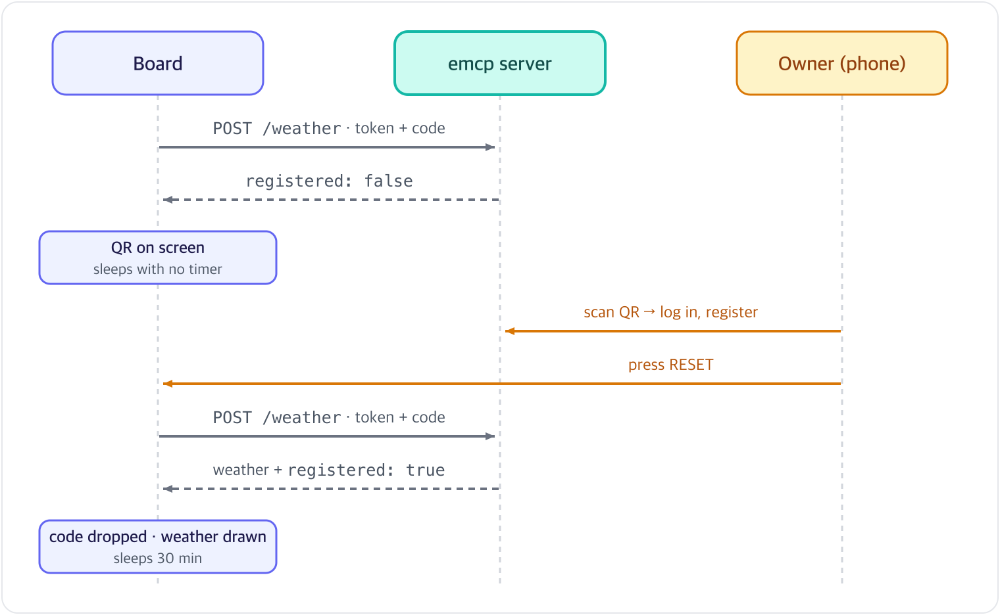

[English](registration.md) | [한국어](../ko/registration.md)

# Registering a board over QR

How a board ends up in someone's account. For the steps a person takes, see [Setup and registration](setup.md).

## The flow

- Registration only starts once Wi-Fi works. A board that cannot reach the network does not try
- Before registration the board sends only its token and code, no readings. The server answers with weather only once the board is registered
- While it waits, the board does not wake up to check. Every time the radio comes on it draws about 100 mA, so instead the owner presses RESET once after registering, and that wake asks again
- Instead of scanning, the code can be typed on the dashboard or given to Claude or ChatGPT

## The two values a board holds
| Value | Form | Role |
|---|---|---|
| Token | 64 hex characters | The board's secret. It goes on every report, and the server keeps only its hash |
| Claim code | 6 characters (e.g. `4J7K2P`) | What a person scans or types. It exists only until the server says registered |

- Both live in NVS. "A token and no code" is a registered board; anything else still has to register
- Only a full NVS erase over USB loses the token. Setting up Wi-Fi again never touches it
- Both are made after Wi-Fi connects: `esp_random()` is a true random source only while the radio is on
- Codes use 32 characters with no 0, 1, I or O, which look alike on a small screen. 32 also divides 2³², so `esp_random() % 32` favours none of them. The server checks the same set

## What each answer does
| Answer | Meaning | The board |
|---|---|---|
| 200 `registered: true` | Registered | Drops the code, draws the weather, sleeps 30 minutes |
| 200 `registered: false` | Nobody has entered the code yet | Shows the QR, sleeps with no timer |
| 409 | Another board is showing the same code | Makes a new code and shows it |
| 401 (a registered board's usual wake) | The server no longer knows the token: the owner released the board | Starts over with a new token and code, shows the QR |
| 429, 503, no answer | The server could not check | Keeps the token. An unregistered board asks again on the next RESET |

- 401 is the only answer that drops a token. Dropping it on a 429 (rate limit) or a 503 (database down) would leave a working board to be registered again
- The code stays the same until it is used. If the server dropped it after its hour, the next ask puts it back

## The screen
- The QR on the left, the code and `emcp.fly.dev` on the right, three steps below (Scan or enter / Log in, register / Press RESET)
- The QR holds `https://emcp.fly.dev/r/<code>`, 29 bytes. That fits a version-2 QR (25×25 modules), so each module is 4 pixels in its 100-pixel box
- Error correction is at the lowest level (L): a crisp screen read up close needs little recovery
- A waiting board that cannot reach Wi-Fi leaves the screen alone. The e-Paper keeps its image without power, so the QR stays up
