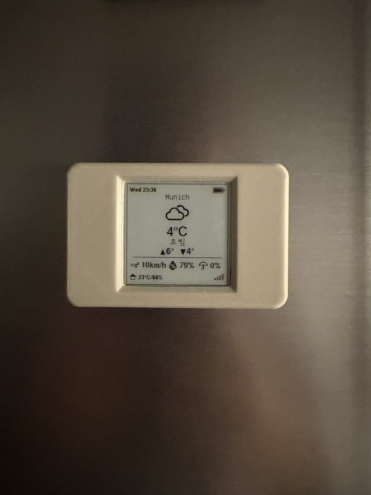
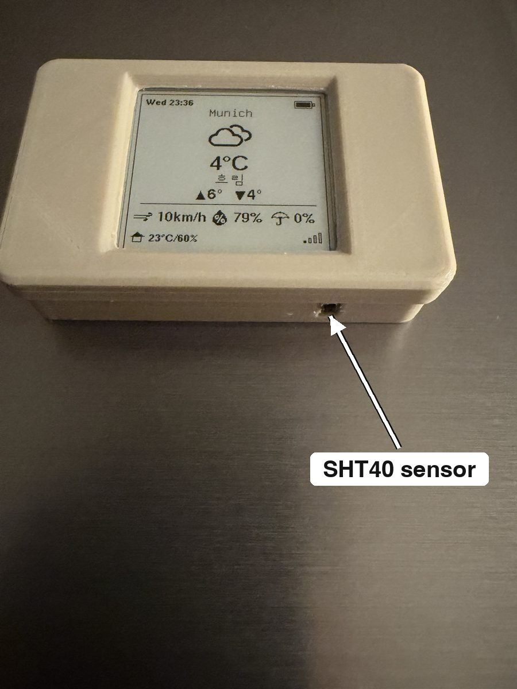
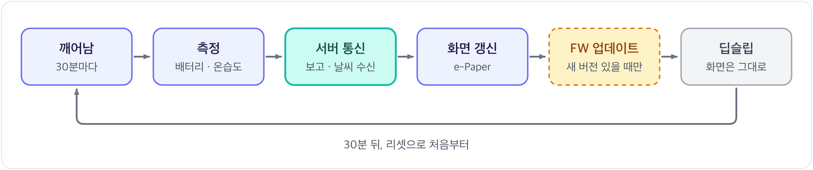
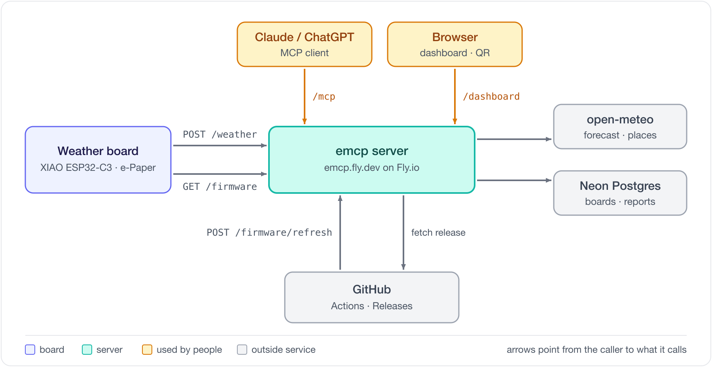
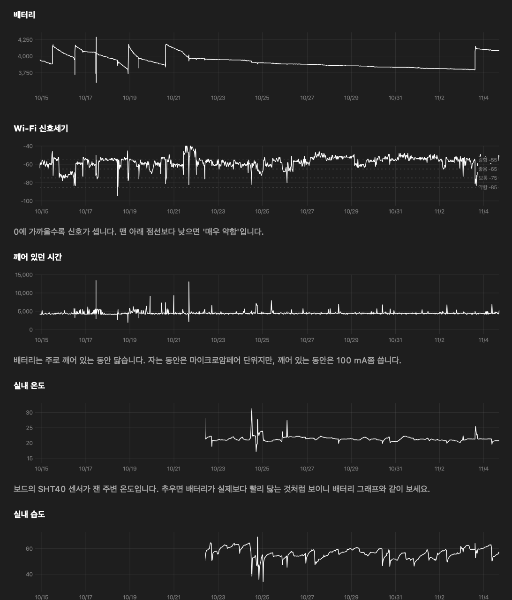

[English](../../README.md) | [한국어](README.md)

# eink-weather-display

 

 

  
  

ESP32-C3와 1.54" e-Paper로 만든 저전력 날씨 표시기. 30분마다 깨어나 날씨와 실내 온습도를 화면에 그리고 다시 딥슬립. 배터리로 수개월 동작.

## 주요 기능
| 기능 | 내용 |
|---|---|
| 날씨 표시 | 지정한 위치의 기온, 최고·최저, 날씨, 바람, 습도, 강수확률. 실내 온습도, 배터리, Wi-Fi 신호도 함께 표시 |
| 저전력 | 갱신할 때만 깨어나고 나머지는 딥슬립. e-Paper는 전원 없이도 화면 유지 |
| 기록 | 깨어날 때마다 배터리, Wi-Fi, 실내 온습도, 그때 받은 날씨를 서버에 저장. 대시보드에서 그래프로 확인 |
| AI 연동 (MCP) | Claude, ChatGPT 앱에서 보드 등록, 날씨 위치 변경, 이름 변경, 최근 7일 기록 조회와 분석 |
| 자동 업데이트 | 새 릴리스를 올리면 보드가 다음 wake에 Wi-Fi로 설치. 실패하면 이전 펌웨어로 자동 복귀 |
| 간단한 설정 | 코드 수정 없이 휴대폰으로 Wi-Fi 설정, 화면의 QR로 내 계정에 등록 |

## 동작 방식

- 보고와 날씨 수신을 HTTPS 요청 한 번으로 처리
- 날씨 정제는 서버 담당. 보드는 받은 값을 그리기만 해서 RAM과 전력 절약

## emcp 서버

서버는 별도 프로젝트 [seung-gu/emcp](https://github.com/seung-gu/emcp). Fly.io에서 동작하며 날씨 조회, 기록 저장, 대시보드, MCP, 펌웨어 배포 담당.

## 펌웨어 자동 업데이트

배포 방법과 세부 규칙은 [펌웨어 구조와 업데이트](firmware.md) 참고.

## 하드웨어
| 부품 | 사용 |
|---|---|
| MCU | Seeed XIAO ESP32-C3 |
| 디스플레이 | Waveshare 1.54" e-Paper V2.1 (200×200, 흑백) |
| 실내 센서 | SHT40 (I2C, 없어도 동작) |
| 전원 | LiPo 배터리 |

핀 연결과 회로는 [하드웨어와 배선](hardware.md) 참고.

## 시작하기
1. 빌드·업로드: `pio run -e weather-xiao -t upload`
2. Wi-Fi 설정: 휴대폰으로 `XIAO-ESP32-C3`에 접속, 브라우저에서 `192.168.4.1`을 열고 네트워크 선택
3. 등록: 화면의 QR을 휴대폰으로 스캔해 대시보드에서 등록 (또는 Claude·ChatGPT에 코드 입력), 보드의 RESET 누르기

Wi-Fi 재설정과 업로드 문제는 [설정과 등록](setup.md) 참고.

## 문서
| 문서 | 내용 |
|---|---|
| [하드웨어와 배선](hardware.md) | 핀 연결, 배터리 분압, 핀을 고른 이유 |
| [설정과 등록](setup.md) | Wi-Fi 재설정, 보드 등록 과정, 다운로드 모드 업로드 |
| [펌웨어 구조와 업데이트](firmware.md) | 코드 구조, 한 번 깨어날 때의 상세 흐름, 업데이트 규칙 |
| [QR로 보드 등록](registration.md) | 토큰과 등록 코드, 서버 응답별 동작, QR 화면 |
| [저장과 화면 갱신](persistence-and-refresh.md) | 마지막 날씨를 NVS에 두는 이유, 딥슬립을 넘어 부분 갱신하는 방법 |
| [NVS에 상태 저장하기](nvs-internals.md) | NVS 구조와 `Preferences` API |
| [JTAG 디버깅](jtag-debug.md) | 내장 USB-JTAG 스텝 디버깅 |
| [GPIO로 e-Paper 모듈 전원 켜고 끄기](epd-power-gating.md) | 모듈 VCC를 GPIO로 끊는 회로 (보류) |
| [저전압 차단](battery-cutoff.md) | 3.4V에서 배터리를 분리하는 P-MOSFET 회로 |
| [배터리 누설전류 Trouble shooting](deep-sleep-drain.md) | V2.1 보드의 RST를 딥슬립 중 LOW로 둬야 하는 이유 |

## 변경 기록
[CHANGELOG.md](https://github.com/seung-gu/eink-weather-display/blob/main/CHANGELOG.md).
