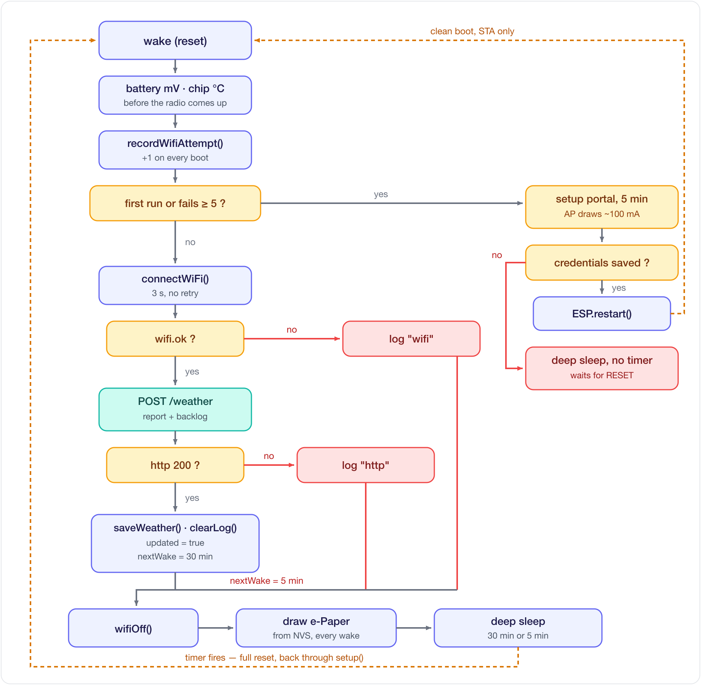

[English](../en/firmware.md) | [한국어](firmware.md)

# 펌웨어 구조와 업데이트

## 한 번 깨어날 때 (상세)


- 모든 작업은 `setup()`에서 처리, `loop()`는 비워 둠. 딥슬립에서 깨어나는 것 자체가 리셋이기 때문
- e-ink는 쌍안정: 화면 유지에는 전류 소비 없음, 갱신할 때만 소비
- 잠든 뒤에도 남아야 하는 상태는 RTC 메모리가 아닌 NVS에 저장 ([저장과 화면 갱신](persistence-and-refresh.md) 참고)
- 서버가 응답하면 30분 뒤, 응답하지 않으면 5분 뒤에 다시 깨어남

## 코드 구조
```
src/
├─ common/          모든 빌드가 공유
│  ├─ config.h         설정 (URL · 핀 · 주기)
│  ├─ net.h/.cpp       WiFi 연결 + HTTPS GET/POST
│  ├─ roots.h          서버 인증서를 확인할 루트 인증서
│  ├─ battery.h/.cpp   분압을 통한 배터리 전압
│  ├─ room.h/.cpp      SHT40 실내 온도·습도
│  ├─ store.h/.cpp     딥슬립·리셋 너머로 NVS에 남기는 값
│  └─ provision.h/.cpp Wi-Fi 설정 포털
├─ weather/         e-Paper 표시기 빌드
│  ├─ display.h/.cpp   e-Paper 초기화 + 렌더링 (전역 객체 static 캡슐화)
│  ├─ weather_icons.h  날씨 아이콘 비트맵
│  ├─ ota.h/.cpp       서버가 알려 준 릴리스 설치, 실패하면 되돌리기
│  └─ main.cpp         흐름 (setup/loop)
└─ led/             LED 전용 빌드
```

## 보드가 서버에 보내는 요청
| 요청 | 용도 |
|---|---|
| `POST /weather` | 깨어날 때마다 상태(배터리, Wi-Fi, 펌웨어, 실내 센서) 보고, 그 보드 위치의 날씨 수신. 새 펌웨어가 있으면 응답에 함께 표시 |
| `GET /firmware/<보드>/<버전>` | 해당 펌웨어 다운로드 |
| `/r/<코드>` | 보드가 직접 부르지는 않음. 등록 전 화면의 QR 주소로, 코드가 채워진 대시보드로 이동 |

## Wi-Fi로 업데이트


```bash
git tag -a v1.1.1 -m "..." && git push origin v1.1.1
```
- 버전은 vMAJOR.MINOR.PATCH. 태그 전에 [CHANGELOG.md](https://github.com/seung-gu/eink-weather-display/blob/main/CHANGELOG.md)에 항목 추가. 번호는 릴리스 스킬(`.claude/skills/release`)이 정함
- `v*` 태그 push 시 GitHub 릴리스 생성, 서버가 바로 수신 (`.github/workflows/release.yml`). Actions 초록 체크는 서버가 받아 둔 상태라는 뜻. 자동 업데이트가 켜져 있고 그 릴리스가 아닌 보드는 다음 wake에 설치. 테스트 빌드를 USB로 올리기 전에 대시보드에서 그 보드의 자동 업데이트를 끄고, 다시 켜면 최신 릴리스로 돌아감
- 보드는 이번 wake의 화면을 먼저 그린 뒤 다운로드. 중간에 끊기거나 손상된 다운로드로는 부팅하지 않음
- 노트북에서 릴리스에 없는 커밋(또는 `-dirty` 빌드)으로 직접 올린 보드는 대상 아님
- 새 펌웨어는 서버 접속과 화면 갱신을 한 번 마쳐야 확정. 실패 시 부트로더가 이전 펌웨어로 복귀. 설치가 안 되면 다음 정기 wake에 재시도, 릴리스 하나당 3번까지, 배터리 3.7V 미만이면 보류. 3번째 뒤에는 보드가 포기했다고 보고하고 서버가 자동 업데이트를 끔. 대시보드에서 다시 켜면 처음부터 재시도
- 이 기능 이전에 올린 보드(`src/weather/ota.cpp` 없음, 기본 파티션)는 USB 업로드 한 번 필요

## 참고
- 날씨 조건 문자열(`뇌우`·`눈`·`비`…)은 서버 응답 매칭용이라 코드에 한국어 유지
