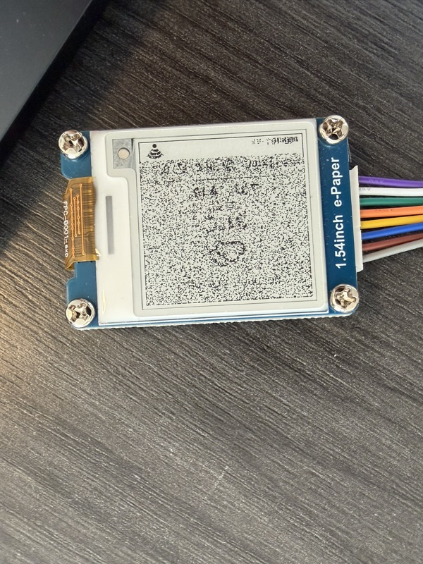

[English](../en/persistence-and-refresh.md) | [한국어](persistence-and-refresh.md)

# 저장과 화면 갱신

딥슬립 웨이크 = 완전 리셋. `setup()`부터 다시 시작하고 일반 RAM은 사라지며, 패널 컨트롤러도 리셋된 상태로 올라옴. 여기서 두 가지가 결정됨:

- 마지막 성공 응답은 RTC 메모리가 아니라 **NVS**(플래시)에 둠
- 화면은 웨이크마다 RTC 메모리에 보관한 직전 화면 위에 **부분 갱신**으로 다시 그림

첫 번째는 이 요구사항 때문: Wi-Fi나 fetch가 실패해도 화면엔 마지막 날씨와 **이번 웨이크**의 상태(`offline`, 신호 게이지)가 떠 있어야 함. 두 번째는 갱신 시간을 2.6초에서 0.5초로 줄임.

갱신 시간과 전류는 이 하드웨어(ESP32-C3 + 1.54" SSD1681 패널) 기준이고 표에 표시함. 아래 GxEPD2 동작은 보드와 무관.

관련: [NVS에 상태 저장하기](nvs-internals.md).

---

## 1. 부분 갱신에는 패널 RAM에 직전 화면이 다시 있어야 함

### 이 모듈의 부분 갱신 방식 (SSD1681)

이 절의 동작은 모두 **이 모듈의 컨트롤러 SSD1681** 기준. 모듈은 Waveshare 1.54" V2.1, GxEPD2 드라이버는 `GxEPD2_154_D67`. 다른 컨트롤러는 확인하지 않음.

컨트롤러는 화면 그림을 자체 RAM 두 장에 들고 있음. 이 RAM은 **ESP32 메모리가 아니라** 디스플레이 모듈 위에 있음:

| RAM | 담는 것 |
|---|---|
| 0x24 | 다음에 보여 줄 화면 |
| 0x26 | 그 직전 화면. 부분 갱신의 비교 기준 |

부분 갱신은 두 RAM을 픽셀마다 비교해서, 값이 다른 픽셀만 바꾸고 나머지는 건드리지 않음. 빠르고 깜빡이지 않는 이유가 이것:

| 0x26 (직전) | 0x24 (다음) | 패널 |
|---|---|---|
| 흰색 | 흰색 | 그대로 |
| 흰색 | 검정 | 검정으로 바꿈 |
| 검정 | 흰색 | 흰색으로 바꿈 |
| 검정 | 검정 | 그대로 |

그래서 **0x26이 패널에 실제로 보이는 그림과 픽셀 단위로 같아야 함**. 다르면 바꿔야 할 픽셀을 그대로 두거나, 이미 맞는 픽셀을 또 구동함.

비교는 **패널 전체**에 걸림. 이 패널에서 하단 상태줄만 부분 갱신 창으로 지정했는데도 화면 전체가 노이즈로 깨졌음(아래 사진). 창은 RAM의 어디에 데이터를 쓸지만 정하므로, 창 밖의 RAM도 맞아야 함.

전체 갱신은 이 비교에 기대지 않음. 화면 전체를 검정·흰색으로 몇 번 깜빡여 모든 픽셀을 정해진 상태로 되돌린 뒤 새 그림을 그림. GxEPD2는 그 전에 두 RAM에 같은 그림을 씀(`writeImageForFullRefresh()`). 전제 조건이 없는 대신 느리고 깜빡임:

| | 갱신 시간 *(이 패널)* | 전제 조건 |
|---|---|---|
| 부분 갱신 | 0.5초 | 0x26에 지금 화면 전체가 들어 있을 것 |
| **전체 갱신** | 2.6초 | 없음 |

이 모듈에서는 0x26이 웨이크를 넘기지 못함. V2.1 보드에서는 RST가 LOW면 모듈 전원이 꺼지는데, 자는 동안 RST를 LOW로 둠. 이유는 [배터리 누설전류](deep-sleep-drain.md) 참고. 깨어날 때도 `displayBegin()`이 RST 펄스로 컨트롤러를 리셋함. 그래서 웨이크마다 0x26을 직접 채워야 함.

### 처음 시도와 실패 원인

처음에는 RAM을 채우지 않고 하단 상태줄만 부분 갱신하려 했음. `init()`의 두 모드가 각각 다르게 실패함:


설치된 GxEPD2 소스가 두 모드를 그대로 기술함:

```cpp
// GxEPD2_154_D67.cpp:274 — refresh(x, y, w, h)
if (_initial_refresh) return refresh(false);   // initial update needs be full update
```

`init(bitrate)`(= `init(bitrate, true)`)는 `_initial_refresh = true`로 두므로, 첫 `refresh(x, y, w, h)`가 조용히 전체 갱신(`_Update_Full()`)으로 바뀌고 부분 창은 버려짐.

```
// GxEPD2_BW.h:320
// NOTE: garbage will result on fast partial update displays,
//       if initial full update is omitted after power loss
```

`init(…, false)`는 그 초기 전체 갱신을 건너뛰므로, `_Update_Part()`가 웨이크가 미정의로 만든 RAM으로 패널 전체를 구동함.

이 패널에서 `init(…, false)` 뒤 하단 ~22px만 `setPartialWindow()`로 갱신했을 때:



### 원인별 해결

| 처음 시도 | 원인 | 지금 방식 |
|---|---|---|
| `init(…, true)`: 날씨 영역이 하얗게 지워짐 | GxEPD2가 두 RAM을 흰색으로 지우고 상태줄만 쓴 뒤, 첫 갱신을 전체 갱신으로 바꿈 | `init(…, false)`로 시작하고, 0x24에 새 화면 전체를 씀 |
| `init(…, false)`: 화면 전체가 노이즈 | 0x26이 정해지지 않은 값이었고, 패널이 화면 전체를 그 값과 비교함 | RTC 메모리에 보관한 직전 화면을 0x26에 다시 써 넣음. 비교가 실제 화면에서 시작함 |
| 상태줄만 다시 그림 | 비교는 창이 아니라 패널 전체에 걸림 | 화면 전체(200 × 200)를 두 RAM에 씀 |

### 지금 방식

웨이크마다 GxEPD2 버퍼 대신 ESP32 메모리의 canvas에 그림(GxEPD2 버퍼는 `private`). 그린 화면은 RTC 메모리(5000바이트)에 복사해 두고, 다음 웨이크가 그 사본에서 시작함:

| 단계 | 호출 |
|---|---|
| GxEPD2의 첫 갱신 전체 강제 없이 시작 | `display.init(115200, false)` |
| 보관한 직전 화면(= 지금 화면에 보이는 것)을 0x26에 | `epd2.writeImageToPrevious()` |
| 새 화면을 0x24에 | `epd2.writeImage()` |
| 화면 전체를 부분 갱신 | `epd2.refresh(0, 0, 200, 200)` |

시작할 직전 화면이 없을 때와 12시간마다는 여전히 전체 갱신:

| 전체 갱신 | 이유 |
|---|---|
| RESET, 전원 차단, 업데이트 뒤 | RTC 메모리가 비워져 보관한 화면이 없음 |
| 메시지나 QR 화면 뒤 | 날씨 화면만 기준으로 보관 |
| 12시간마다 (30분 간격으로 24번째) | 보험. 테스트에서 도시를 바꿔 모든 값과 아이콘이 바뀌어도 잔상 없었음 |

테스트에서 부분 갱신 웨이크는 1.9–2.5초, 전체 갱신 웨이크는 약 4.6초.

---

## 2. 마지막 응답은 RTC 메모리가 아니라 NVS(플래시)에

fetch 실패 시 직전 날씨를 다시 그리려면 마지막 성공 응답이 웨이크를 넘어 살아 있어야 함. RTC SRAM은 딥슬립만 버팀. NVS는 이 기기가 겪는 모든 리셋을 버팀.

| | `RTC_DATA_ATTR` (RTC SRAM) | **NVS (플래시)** |
|---|---|---|
| 딥슬립 웨이크 | 유지 | 유지 |
| 리셋 버튼 / `ESP.restart()` | **소실** | 유지 |
| 전원 차단, 배터리 교체 | **소실** | 유지 |
| 펌웨어 재업로드 | **소실** | 유지 (NVS 파티션은 안 건드림) |
| 접근 | 변수 직접 사용, 복사 불필요 | `Preferences` get/put |

리셋 버튼과 재플래시는 개발 중 일상이고, 그때마다 RTC 메모리는 비워져 화면에 다시 그릴 내용이 남지 않음.

### 전력 비용

NVS 쓰기는 깨어 있는 Wi-Fi 구간 옆에서 사라지는 수준:

| | 소비 *(이 보드)* |
|---|---|
| Wi-Fi 접속 + HTTPS | ~80–120 mA × 1–4초 ← 지배적 |
| e-Paper 전체 갱신 | ~10 mA × 2.6초 |
| **NVS 쓰기** | ~15 mA × ~10 ms (≈ 0.04 mAs) |
| 딥슬립 (둘 다 동일) | ~5 µA — 웨이크 타이머 때문에 RTC 도메인은 어차피 켜져 있음 |

### 플래시 수명

NVS는 페이지에 엔트리를 추가하다가 페이지가 찰 때만 지우고, **값이 같으면 쓰기 자체를 건너뜀.** 이 웨이크 주기에서 erase 예산은 한계 근처에도 못 감:

| | |
|---|---|
| NOR 내구성 | 섹터당 약 10만 회 erase |
| 쓰기 | 10분에 1회 ≈ 연 52,500회 |
| 값 크기 | ~100바이트 |
| `nvs` 파티션 | ~20KB (기본) |
| 섹터 erase | 연 수백 회 |
| **여유** | **수십 년** |

초 단위 주기로 내릴 때부터 신경 쓸 문제가 됨. 엔트리 단위 계산: [NVS에 상태 저장하기](nvs-internals.md) §6.

---

## 3. 최종 흐름

```cpp
WifiResult wifi = connectWiFi();               // 1회 + 재시도 1회, 재부팅 루프 없음

String fetched;
if (wifi.ok) fetched = httpGet(WEATHER_URL);   // 1회 + 재시도 1회 (서버 콜드스타트 대비)

// NVS가 단일 소스: 새 값이 있으면 저장하고, 화면은 항상 저장된 값을 그림
prefs.begin("weather", false);
if (fetched.length()) prefs.putString("last", fetched);
String w = prefs.getString("last", "");
prefs.end();

displayBegin();                                // 항상 다시 그림 (부분 또는 전체, §1)
displayWeather(w, wifi.ok ? wifi.ms : 0,       // 0 ms  -> "offline"
                  wifi.ok ? wifi.rssi : 0);    // 0 dBm -> 빈 게이지
```

| 상황 | 화면 |
|---|---|
| Wi-Fi ✓ fetch ✓ | 새 날씨 + 접속 시간 + 신호 게이지 |
| Wi-Fi ✓ fetch ✗ | 직전 날씨(NVS) + 접속 시간 + 게이지 |
| Wi-Fi ✗ | 직전 날씨(NVS) + `offline` + 빈 게이지 |
| 저장된 값 없음 | 빈 테두리 + `offline` |

상태줄은 항상 **이번 웨이크**를 반영하므로, 오래된 화면인지 방금 갱신된 화면인지 구분됨.
