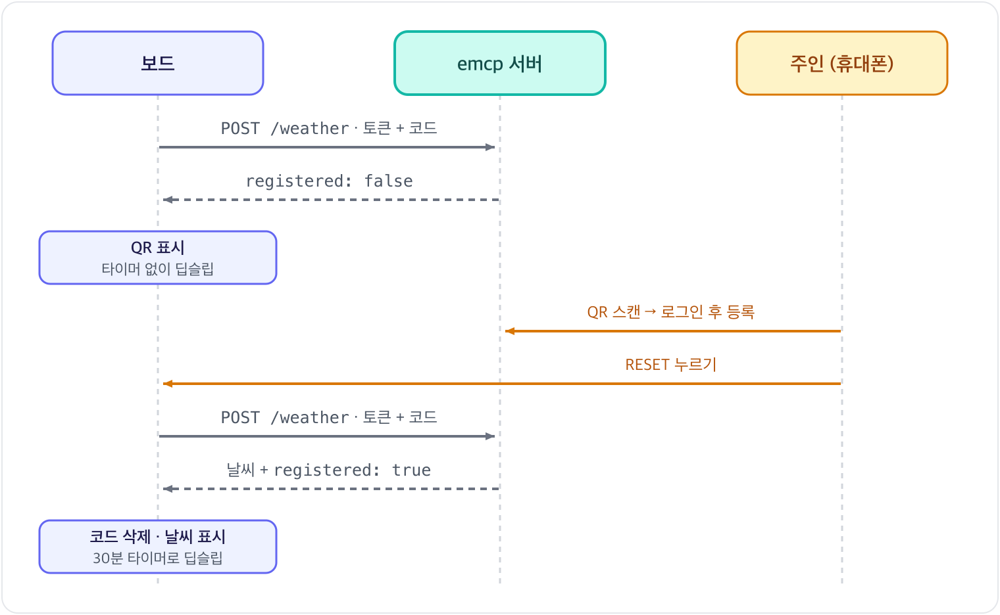

[English](../en/registration.md) | [한국어](registration.md)

# QR로 보드 등록

보드가 사람의 계정에 들어가는 과정. 사용 방법은 [설정과 등록](setup.md) 참고.

## 흐름

- 등록은 Wi-Fi 연결 뒤에만 진행. 네트워크에 닿지 못한 보드는 등록을 시도하지 않음
- 등록 전 보드는 측정값 없이 토큰과 코드만 전송. 서버는 등록된 보드에만 날씨 응답
- 기다리는 동안 보드는 깨어나서 확인하지 않음. 라디오를 켤 때마다 약 100 mA를 쓰므로, 사람이 등록한 뒤 RESET 한 번으로 다시 묻는 방식
- 코드는 QR 스캔 대신 대시보드에 직접 입력하거나 Claude·ChatGPT에 알려 줘도 등록 가능

## 보드가 가진 두 값
| 값 | 형태 | 역할 |
|---|---|---|
| 토큰 | 16진수 64자 | 보드의 비밀값. 모든 보고에 실리고 서버는 해시만 저장 |
| 등록 코드 | 6자 (예: `4J7K2P`) | 사람이 스캔하거나 입력하는 값. 서버가 등록됐다고 답할 때까지만 존재 |

- 둘 다 NVS에 저장. "토큰 있음, 코드 없음"이 등록된 보드이고 그 밖은 모두 등록 필요
- 토큰은 USB로 NVS를 통째로 지울 때만 사라짐. Wi-Fi를 다시 설정해도 그대로
- 둘 다 Wi-Fi가 연결된 뒤에 생성. `esp_random()`은 라디오가 켜져 있을 때만 진짜 난수
- 코드 문자는 0, 1, I, O를 뺀 32자. 작은 화면에서 헷갈리는 글자를 뺐고, 32가 2³²를 나누어떨어지게 해서 `esp_random() % 32`가 어느 글자에도 치우치지 않음. 서버도 같은 문자 집합으로 검사

## 서버 응답별 동작
| 응답 | 뜻 | 보드 동작 |
|---|---|---|
| 200 `registered: true` | 등록 완료 | 코드 삭제, 날씨 표시, 30분 타이머로 딥슬립 |
| 200 `registered: false` | 아직 아무도 코드를 입력하지 않음 | QR 표시, 타이머 없이 딥슬립 |
| 409 | 다른 보드가 같은 코드를 쓰는 중 | 새 코드를 만들어 표시 |
| 401 (등록된 보드의 평소 wake) | 서버가 토큰을 모름. 주인이 등록을 해제한 경우 | 새 토큰과 새 코드로 처음부터 시작, QR 표시 |
| 429, 503, 응답 없음 | 서버가 확인하지 못함 | 토큰 유지. 등록 전이면 다음 RESET에 다시 확인 |

- 토큰을 지우는 응답은 401 하나뿐. 429(요청 제한)나 503(DB 장애)에 지우면 멀쩡한 보드를 다시 등록해야 함
- 코드는 쓰일 때까지 그대로. 서버가 한 시간 뒤 코드를 지웠어도 다음 확인 때 다시 올라감

## 화면
- 왼쪽에 QR, 오른쪽에 코드와 `emcp.fly.dev` 주소, 아래에 세 단계 안내 (Scan or enter / Log in, register / Press RESET)
- QR 주소는 `https://emcp.fly.dev/r/<코드>`, 29바이트. 버전 2 QR(25×25 모듈)에 들어가서 100픽셀 칸에 모듈 하나가 4픽셀
- 오류 정정은 가장 낮은 단계(L). 가까이서 찍는 선명한 화면이라 복구 여유가 거의 필요 없음
- 등록을 기다리는 보드가 Wi-Fi에 닿지 못하면 화면을 그대로 둠. e-Paper는 전원 없이 그림을 유지해서 QR이 계속 보임
